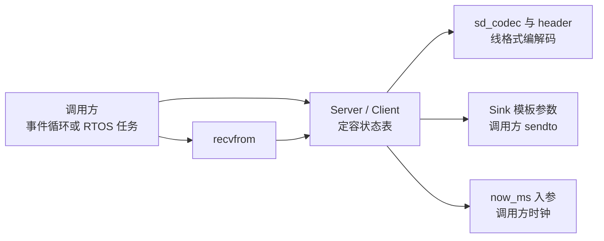

# 把 SOME/IP 写成不碰操作系统的协议核心

2026-11-21 · osp-someip · 阅读约 15 分钟

osp-someip 不打算替代 vsomeip，它只是把「SOME/IP 协议本身」这部分单独拿出来，做到能塞进一个没有堆、
没有多线程、不接受框架的运行环境里——并且用可执行的证据说明它确实塞得进去。

在这个前提下，三个结论：

1. osp-someip 与 vsomeip 不在同一层。vsomeip 3.4.10 是带 routing manager、JSON 配置体系、插件与
   线程池的运行时框架，以共享库形式交付；osp-someip 是 30 个头文件、在编译期展开进调用方的协议核心，
   不含 socket、不含线程、全链路零堆分配。
2. 两者在网络上能互通，双向实测通过（发现、订阅、事件、RPC）。前提是对端配置里给出 UDP
   （`unreliable`）端口。明确不兼容的是 TCP 端点与 IPv6 收发路径。
3. 只有 UDP 不是「来不及做 TCP」，是范围取舍：大载荷已由 SOME/IP-TP 覆盖，而 TCP 的收发缓冲与连接
   状态机会同时破坏本库的两条边界——编译期内存上界、协议核心不碰操作系统。

支撑这三条结论的实测数据（2026-11-21，同一台 x86-64 主机，Linux 6.5、gcc 11，两侧都是「offer 一个
服务、一个事件组、SD 周期运行」进入稳态后取样）：

| 项 | vsomeip 3.4.10 | osp-someip |
|---|---|---|
| 稳态线程 | 7 | 1（库本身 0 线程） |
| VmData | 50,108 kB | 264 kB |
| VmRSS | 7,200 kB | 2,400 kB |
| VmSize | 321,636 kB | 6,084 kB |
| 代码段 | 3,341,398 字节（`libvsomeip3.so` 2,838,186 + `libvsomeip3-cfg.so` 503,212） | 26,028 字节（示例服务端可执行文件，协议代码全部在内） |
| 实现规模 | `implementation/` 72,940 行、336 个文件 | `include/` 5,411 行、30 个头文件；`tests/` 另 5,492 行 |
| 运行期依赖 | `libvsomeip3.so.3`、`libvsomeip3-cfg.so`、`libboost_thread.so.1.74.0` | 无 |

复现口径与完整表格见 [comparison_with_vsomeip_zh.md](comparison_with_vsomeip_zh.md)。

## 1. 起因：有一类目标机装不下运行时框架

vsomeip 在车载 Linux 上是事实标准，这一点没有争议。但它假设了三件事：进程里有一个堆可以随便用、
框架可以拥有自己的线程、应用启动时能读一份 JSON 配置。IVI 域控制器上这三条都成立，MCU 与部分
RTOS 上不成立。

具体到本项目要覆盖的目标机，约束是这四条：

- **没有可用的堆，或者堆必须留给业务**。协议栈的内存占用要能在编译期算出来，不能「取决于对端发了
  多少条消息」。
- **不接受框架自带线程**。目标机上已经有一个事件循环或一个 RTOS 任务在跑，协议栈要么嵌进去，
  要么就不该进来。
- **要过静态审查**。异常、RTTI、vtable、`std::function`、动态分配的池和工厂，在审查清单上都是要
  逐条解释的项。能整类消掉比逐条解释划算。
- **收发与时钟要可替换**。同一份协议代码既要在 Linux 上用真实 socket 跑互操作，也要能在没有
  操作系统的测试夹具里跑，还要有希望接进 lwIP。

这四条决定了设计方向：把 SOME/IP 做成一个纯函数式的核心——喂给它字节、端点、当前时间，它吐回字节
和回调，其余一概不管。

起点也不是白纸。线格式与 SD 语义来自上游 Rust 原型
[simple_someip](https://github.com/luminartech/simple_someip)（simple-someip 0.15，MIT OR
Apache-2.0）：19 条线格式 golden 字面量逐字节同源移植，vsomeip 互操作的对端程序 `peer` 取自它的
`tests/data/vsomeip-peer`。C++17 这一版不是逐行翻译，而是把 async 执行器换成「调用方驱动加定容加
无堆」，并补上原型没有的三样：SOME/IP-TP 分段重组、E2E Profile 1/2/4/5/7、`RequestHandler`
类型化请求分发。反过来，原型仍有三样本项目没跟：更完整的 Find/Offer 时序（initial delay 随机化、
repetition 阶段、cyclic delay 对 TTL 的合法性校验）、payload 类型序列化
（`automotive-wire-codec` 的 `Encode` / `Decode`）与可直接运行的 bare-metal 运行时
（embassy-executor 加 callback transport）。逐项对照见
[comparison_with_rust_zh.md](comparison_with_rust_zh.md)。

许可证决定了两个参考项目的角色分工：Rust 原型是 MIT OR Apache-2.0，允许移植（保留声明），因此可以
作为行为基线与 golden 来源；vsomeip 是 MPL-2.0，只做黑盒对端，一行源码都不进本仓库。测试期望值
（oracle）只允许来自规范与手写字面量，不允许「把某个实现的输出抄成期望值」——那会把对端的缺陷一起
继承过来。分工细则见 [reference_projects_zh.md](reference_projects_zh.md)。

## 2. 三条硬边界



### 2.1 不拥有 socket

核心 API 只有三类入口：

```cpp
server.Offer(service, local_endpoint, ttl, now_ms);   // 声明状态
server.HandleDatagram(datagram, source, now_ms);      // 喂一个数据报
server.Tick(now_ms);                                  // 推进重播与超时
```

发送经模板参数 `Sink` 出去，签名就是「一段字节加一个目标端点」：

```cpp
struct UdpSink {
  void operator()(osp::span<const std::uint8_t> datagram,
                  const osp::someip::Ipv4Endpoint& to) noexcept {
    // sendto(to.address, to.port, datagram)
  }
};

osp::someip::Server<UdpSink, 8U, 16U, 1400U, Echo> server(sink);
```

`Sink` 与请求处理函数 `RequestHandler` 都是类型参数，编译期绑定，调用点直接是
`sink_(datagram, endpoint)`。因此没有 `std::function`、没有 vtable、没有为回调分配的内存，
整个库在 `-fno-exceptions -fno-rtti` 下全量构建。

### 2.2 不拥有线程与时钟

所有定时行为（cyclic offer、TTL/2 重播、TTL 到期、find 倍增重发、请求超时、订阅半 TTL 续订）都不
自己起定时器，而是在 `Tick(now_ms)` 里比对时间戳。时间是入参，不是库去问操作系统。这一条让协议核心
可以在测试夹具里以任意步长快进，也是它能接进单线程事件循环的前提。

### 2.3 不分配堆

解析结果是调用方缓冲区上的 `osp::span` 视图，容器是定容数组，编码写进调用方给的缓冲。实例大小因此
可以在编译期算出来（x86-64 与 aarch64 一致，都是 LP64 加定容数组）：

| 类型 | 字节 |
|---|---|
| `Server<Sink>`（8 offer / 16 订阅 / 1400 字节数据报缓冲 / 8 个远端服务） | 2168 |
| `Client<Sink, Handler>`（默认容量） | 2704 |
| `TpReassembly<4096, 1>` | 4140 |
| `Server` 加上 `TpReassembly<4096, 1>` | 6304 |
| `E2EProfile1<DataId>` | 3 |

零分配不是文档里的一句承诺，而是一个可执行门禁。`tests/no_alloc_witness.cpp` 替换全局
`operator new` 与 `operator delete` 为计数版本，跑完 offer → find → subscribe → publish → tick
一整条链路，只要发生过一次堆分配就返回非零。它是 `ctest` 里的一项（`someip_no_alloc`），后续谁往
热路径里塞一个 `std::vector` 或 `std::string`，这条会直接红。

## 3. 协议面：够做一次真实集成

- **线格式**：16 字节头、消息编解码、数据报遍历（按 Length 字段切分，畸形消息产出 `kMalformed`
  并停止，尾部不足一头的字节原样交出）。
- **Service Discovery**：entry / option / header 的编解码与零拷贝视图，Find、Offer、StopOffer、
  Subscribe、Ack 数据报构建，会话计数，TTL 到期与 TTL/2 重播。
- **服务端**：offer 槽表、find 应答（支持通配）、订阅管理、事件发布、远端 offer 观察者。
- **客户端**：发现缓存、find 倍增重发、请求匹配与超时、订阅半 TTL 续订、服务可用性回调、
  对端重启检测。
- **SOME/IP-TP**：按 16 字节单元记录到达情况，支持乱序重组，重叠分段丢弃，按（消息 ID，请求 ID）
  区分会话，超时释放。不启用 `TpReassembly` 时不占内存。
- **E2E**：策略模板，发送前 Protect、接收时 Check，校验失败丢弃；默认 `NoE2E`，不产生开销。
  内置 Profile 1（CRC-8 SAE J1850）、2（CRC-8/H2F 加计数器状态机）、4（CRC-32/AUTOSAR）、
  5（CRC-16/CCITT-FALSE）、7（CRC-64/XZ）。vsomeip 3.4.10 只有 1、4、7 与 custom。

`include/` 5,411 行、`tests/` 5,492 行——测试比实现大，这是刻意的：协议栈的正确性主要靠字节级
对照，不靠代码量。

## 4. 为什么不需要 TCP

这是最常被问到的一条，理由按权重排列：

1. **大载荷已经由 SOME/IP-TP 覆盖**。UDP 上的分段与重组实现了乱序、重叠丢弃、会话隔离与超时释放。
   事件与有界 RPC 这两个主要场景不需要 TCP 的字节流语义。
2. **TCP 的内存代价与本库的预算直接冲突**。每条连接要有 PCB、收发缓冲、重传队列与拥塞窗口状态；
   lwIP 上一个 TCP PCB 加缓冲是数 KB 量级，而本库一个服务端实例是 2.1 KB，并且要求编译期定容。
   更要紧的是 TCP 缓冲会随对端行为增长，给不出静态上界。
3. **TCP 的生命周期必须持有 socket 与时钟**。connect、握手、ACK、重传定时、半开连接检测都要主动
   发起 I/O 并挂定时器。把 TCP 放进来就得把连接状态机一起放进来，「协议核心不碰操作系统」这条边界
   随即消失。
4. **实时性与可分析性**。重传与拥塞控制让时延没有上界，缓冲占用也无法静态分析。安全相关或硬实时
   场景的常见做法是 UDP 加 E2E 保护加应用层超时——本库的 Profile 1/2/4/5/7 与请求超时正是这条
   路线上的零件。
5. **未验证的平台上不叠未验证的面**。RT-Thread 侧 lwIP 运行时收发还没打通，在这个基础上再加一个
   TCP 状态机，只会让未验证面积翻倍。

需要澄清一点：线格式层面并没有「不认识」TCP。SD endpoint option 的 protocol 字节有枚举
（`TransportProtocol::kTcp = 0x06`）与合法性校验，缺的是端点机制，不是解码能力。

上游 Rust 原型也是同一口径，这一点值得单独说：simple_someip 0.15 里没有任何 TCP socket（std 后端是
`tokio::net::UdpSocket`，bare-metal 后端是 embassy-net / smoltcp 的 UDP socket），发送路径用模式匹配
强制 `(SocketAddr::V4, TransportProtocol::Udp)`，端点是 TCP 或 IPv6 就直接返回
`Error::UnsupportedEndpoint`；它的服务端还留着一条 warn，写明「TCP+UDP 多端点订阅者尚未支持」。
差别只在拒绝发生的层次：上游在发送层挡下，本库在解析层就把非 0x11 的 endpoint option 过滤掉。
所以只有 UDP 不是本项目单独偷的懒，是这条实现血统一致的范围取舍。

仍然需要 TCP 的场景是真实存在的：单条消息超过 TP 重组容量、对端只提供 reliable 端点、跨公网传输、
需要面向连接的背压。这类场景建议直接用 vsomeip，或在调用方侧另建通道，本库不打算覆盖。

## 5. 兼容吗：网络上互通，边界要说清

**能互通，双向都实测过**。对端是 vsomeip 3.4.10（Release，Boost 1.74），跑的是取自 Rust 原型的
`peer` 程序（`simple_someip/tests/data/vsomeip-peer`，自身即 routing manager）。本机账号不在
docker 组，因此没有用容器，而是把两套栈放进各自的网络命名空间、用 veth 对连：两边各有地址与端口
空间，都能绑 30490，效果等同双机部署，且用户命名空间里就有建 veth、配地址、开组播的权限。SD 走
239.255.0.255:30490，TTL 3 s，cyclic offer 1000 ms。脚本是 `tools/vsomeip_interop.sh`。

| 方向 | 观察到的消息 | 结果 |
|---|---|---|
| 本方服务端 ← vsomeip 客户端 | vsomeip 收到 `AVAILABLE`、`SUBSCRIPTION ... status=accepted`、6 条 `EVENT ... 0x8001`、`RESPONSE ... payload=deadbeef`；本端 `1 subscriber(s)` 与 `request 0x0001 from 10.0.0.2` | 通过 |
| 本方客户端 → vsomeip 服务端 | 本端 `service 0x1234/0x0001 available`、`subscribe ack ttl=10`、`response 0x00010001`、`event 0x8001`；vsomeip 日志出现 `REQUEST ... payload=01020304` | 通过 |

**明确不兼容的三项**：

- TCP 端点：对端只提供 reliable 端点时无法通信，本库不发也不收 TCP。
- IPv6 传输：IPv6 endpoint 与 multicast option 能编解码，但没有收发路径。
- 多应用共享一条路由：那是 vsomeip 进程内部的结构，与网络互通无关。

**还没覆盖的**：E2E 保护过线对 vsomeip（只做过 CRC 逐字节核对）、SOME/IP-TP 过线对 vsomeip
（只与 Python 探针对过分段与重组）、多实例与多事件组、长时间运行的稳定性与内存趋势、跨交换机组播。
TLS 两边都没有（vsomeip 3.4.10 源码里也没有 `SSL_CTX`）。

现实的共存形态是：一端是既有 vsomeip 工程，另一端是受限设备，网络上互通。

## 6. 互操作才暴露的缺陷：option 类型合法不等于语义可用

跑通 vsomeip 之后又修掉一个真问题，值得单独记一笔。

SD 的 endpoint option 里有一个 protocol 字节，0x11 是 UDP、0x06 是 TCP。修复前有三处代码只看 option
类型、不看这个字节：客户端的发现缓存、服务端的远端 offer 观察者、订阅目标解析。后果是，如果对端
offer 或 subscribe 的第一个 endpoint option 是 TCP，本库会把 UDP 数据报发往对端的 TCP 端口——报文
送不到，还可能打到无关的监听者。

自己的测试发现不了它：本库两侧都只声明 UDP 端点，构造不出 TCP option。是「对端会怎么声明」这个问题
把它逼出来的。

修法是最小改动：新增 `SdHeaderView::UdpEndpointOption(entry, out)`，遍历该 entry 两个 option run
引用的全部选项，只接受「已知类型 + IPv4 endpoint + protocol = 0x11」，一个都没有时回退到 SD 报文的
源地址；三处调用点改为统一走它。对外可见的行为变化只有一条：只声明 TCP 端点的服务仍会触发
`OnServiceAvailable`，但不会被当成发送目标——这类服务对本栈实际不可用，需要在对端配置里给出 UDP
端口。补了 4 个用例，都用手工构造的 SD 数据报显式放入 TCP endpoint option，覆盖 TCP-only、TCP 排在
UDP 前面、以及选项落在第二个 option run 这三种情况。

教训是通用的：解析器把字段校验通过，和业务上能用这个字段，是两件事。跨实现测试的价值恰恰在第二类
问题上。

## 7. 验证与性能：四条独立证据链

协议栈最怕「自己测自己」，所以对照物尽量来自仓库之外：

1. **手写 golden 加模糊扫描**。线格式期望值由人按布局推导，19 条 golden 与 Rust 原型同源、逐字节
   移植（属于「可移植来源」这一类，不是抄某个实现的输出）；SD / TP / E2E 三类做模糊扫描；E2E 的
   CRC 校验值只用标准目录里的公开值（如 Profile 4 的 `0x1697D06A`、Profile 7 的
   `0x995DC9BBDF1939FA`）。
2. **第二套独立实现**。`tools/sd_probe.py` 只用 Python 标准库，可当客户端或服务端，与 C++ 侧双向
   对跑；TP 分段也用它驱动（128 字节请求切 4 段，服务端重组回显）。
3. **与参考实现逐字节核对**。E2E Profile 2 对 AUTOSAR 官方 C 实现（`E2E_P02.c` 加 `Crc.c`）：
   11 条消息的 Protect 输出逐字节一致，8 步接收序列的状态（INITIAL / OK / OKSOMELOST / REPEATED）
   一一对应。Profile 4 与 7 把 vsomeip 的 `crc.cpp`、`profile_04.cpp`、`profile_07.cpp` 编进同一个
   临时进程，对 1000 组随机缓冲比较，差异为 0。这些临时程序没有入库，也不作测试 oracle。
4. **跨实现与跨指令集运行**。vsomeip 双向互操作（第 5 节）；aarch64 交叉构建后在 qemu-user 与
   qemu-system（完整内核加 busybox initramfs）下都跑过。

构型矩阵与结果：Debug、Release 加 `-fno-exceptions -fno-rtti`、ASan 加 UBSan、aarch64 四种构型编译
零告警；主机 `ctest` 161 项全过（本机另给了 `SOMEIP_LWIP_DIR`，因此是 162 项），158 个用例、
53,055 条断言；qemu-system 全内核下 158 个用例（157 过 1 跳过，跳过的是需要真机网卡的组播用例）、
demo 与基准 RC 均为 0，基准 `avg=106.2us p50=102us p99=214us rate=8948 req/s`。静态检查 cpplint
0 条，clang-tidy 只剩 12 条 `bugprone-easily-swappable-parameters`（已记录为接受的偏差），
`performance-*` 0 条。覆盖率只作趋势不作门禁：行 58.0%、函数 69.8%、分支 36.7%
（`server.hpp` / `client.hpp` 是模板，gcov 按实例计数，因此偏低）。

一个会咬人的环境细节：ASan 构型在 gcc 11 加 kernel 6.5 上要关掉地址随机化再跑，否则 libasan 与高熵
ASLR 冲突，大约每 20 次启动崩 1 次，现象是没有报告的 `AddressSanitizer:DEADLYSIGNAL`，整轮 `ctest`
会随机挂掉几十项。用 `setarch $(uname -m) -R ctest --preset asan`。这是工具链与内核的组合问题，
不是内存缺陷。

性能基线（单进程、双真实 UDP 套接字、8 字节回显载荷、3000 次往返、忙轮询）：

| 平台 | p50 | p99 | 吞吐 |
|---|---|---|---|
| x86-64，机器空闲 | 5 µs | 9–12 µs | 约 15.7 万–16.6 万次请求/秒 |
| x86-64，loadavg≈37 / 100 核 | 6 µs | 10–24 µs | 约 12.5 万–14.4 万次请求/秒 |
| aarch64，qemu 用户态 | 11–14 µs | 27–49 µs | 约 5.4 万–6.6 万次请求/秒 |

这组是回环上限参考，不是目标板数据：忙轮询消除了调度抖动（真实 `epoll` 唤醒会更差），单进程共享
缓存（不能外推到跨进程或多核），qemu 用户态的抖动主要来自模拟器本身。顺带一条经验：这个基准不要用
`taskset` 绑核，两端抢同一个核会让 max 冲到 8–16 ms。

## 8. 这个库不替你做什么

写清楚边界比写清楚功能更重要。以下是范围声明，不是待办：

- **没有 payload 类型序列化**。本库只搬字节，IDL 生成的类型编解码归调用方。
- **没有 routing manager 与本地 IPC**，没有应用注册与凭证校验。一个实例就是调用方进程里的一个对象。
- **没有 JSON 配置体系**，没有插件机制，没有分级日志。参数在编译期或调用点给出，状态只经回调交出。
- **没有网卡状态跟踪**（vsomeip 的 `netlink_connector`）与安全策略，这些依赖进程模型。
- **没有 TCP 端点、没有 IPv6 收发、没有 TLS**。

需要上面任何一条，选 vsomeip。

## 9. 选型三问与上手

选型只看三个问题：目标机能不能给它一个堆；能不能接受框架自带的线程与配置体系；协议要不要嵌进已有的
事件循环或 RTOS 任务。三个答案依次是「不能给堆」「不能接受」「要嵌进去」时用 osp-someip；只要有
一个反过来，vsomeip 更省事。

上手：

```bash
cmake -S . -B build -DOSP_GITHUB_MIRROR=https://ghfast.top/
cmake --build build -j8
ctest --test-dir build --output-on-failure
```

依赖只有 [newosp](https://github.com/DeguiLiu/newosp) 的头文件，钉 v0.9.6（GitHub 最新 release）：
默认从同级目录 `../newosp/include` 取；没有就加 `-DSOMEIP_FETCH_NEWOSP=ON` 让 CMake 去拉。它不进
链接闭包，也不随本包安装，用 `find_package(osp_someip)` 的消费方需要自备 newosp 的 include 路径。

想看它跑起来：

```bash
cmake -S . -B build-demo -DSOMEIP_BUILD_EXAMPLES=ON && cmake --build build-demo -j8
./build-demo/examples/someip_server_demo --iface 127.0.0.1 --service 1234 --seconds 6 &
./build-demo/examples/someip_client_demo --server 127.0.0.1 --local 127.0.0.1 \
    --port 30510 --service 1234 --method 0001 --seconds 4
```

同一份源码还编出五个 E2E profile 的服务端/客户端变体，以及一个不走套接字的分段重组示例
（`someip_fragmented_demo`：E2E 保护加 19 段 TP 重组）。

延伸阅读（都在本仓库）：

| 文档 | 内容 |
|---|---|
| [api_zh.md](api_zh.md) | 公开接口速查与最小示例 |
| [design_zh.md](design_zh.md) | 架构、模块划分、关键取舍 |
| [comparison_with_vsomeip_zh.md](comparison_with_vsomeip_zh.md) | 与 vsomeip 的完整对照、为什么不需要 TCP、互通边界 |
| [validation_lanes_zh.md](validation_lanes_zh.md) | 四条验证通道的命令与结果 |
| [benchmark_report_zh.md](benchmark_report_zh.md) | 回环性能基线与测量条件 |
| [static_analysis_zh.md](static_analysis_zh.md) | cpplint / clang-tidy 结论与偏差 |

一句话收尾：这个库的每条能力都对应一个可执行的证据——零分配见证进程、手写 golden 字面量、只用标准库
的 Python 第二实现、vsomeip 双向互操作、qemu-system 全内核运行。文档会过期，门禁不会。
