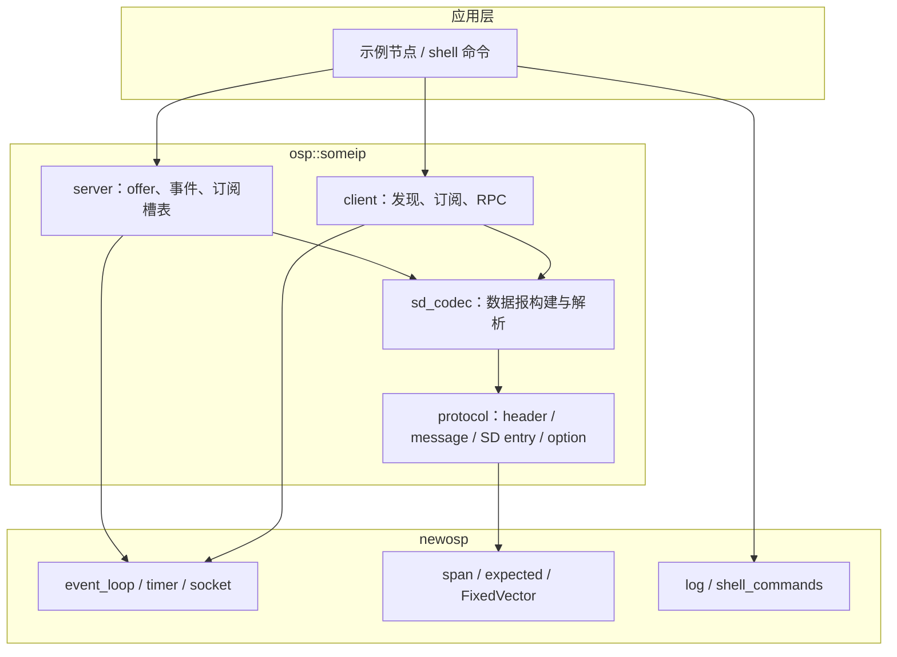

# osp-someip 架构设计

## 1. 范围与目标

本仓库用 C++17 重新实现 SOME/IP（含 Service Discovery），面向嵌入式 Linux 与 RT-Thread，
以 newosp 的头文件库为运行底座。目标不是逐行翻译 Rust 原型，而是保留其线格式与协议行为，
把异步执行器替换为 newosp 的事件循环与静态通道。

| 范围内 | 范围外 |
|---|---|
| SOME/IP 头、消息、SD entry/option 编解码 | SOME/IP-TP 重组（仅跳过并计数） |
| 服务端 offer/stop-offer、事件发布、订阅管理 | E2E 保护的具体 profile（只留钩子） |
| 客户端发现缓存、订阅、请求-响应匹配 | TLS/mTLS 与安全传输 |
| 定容、零分配、无异常的错误模型 | 动态分配、vtable 多态、工厂模式 |

硬约束：C++17；`-fno-exceptions -fno-rtti` 可构建；热路径零堆；单函数 return 不超过 5 个；
新增常量用 `constexpr`，禁裸 `enum` 与业务 `#define`。

## 2. 架构与模块



模块职责：`protocol` 只做字节与值对象，不碰 socket；`sd_codec` 在调用方缓冲上构建整条 SD 数据报；
`server` 与 `client` 持有定容状态表，通过 `TransportOps` 策略注入收发；应用层只组合，不解析字节。

当前已落地 M0 的文件：`wire.hpp`（写入器与编码器骨架）、`header.hpp`、`message.hpp`、
`payload.hpp`、`message_id.hpp`、`message_type.hpp`、`return_code.hpp`、`error.hpp`。

## 3. 关键设计决策

### 3.1 编码：CRTP 骨架 + 单一出口

每个线格式类型派生自 `WireEncoder<T>`，只实现两个钩子：

```cpp
std::uint32_t DoEncodedSize() const noexcept;
osp::expected<std::uint32_t, Error> DoEncodeTo(osp::span<std::uint8_t> out) const noexcept;
```

基类的 `EncodedSize()` / `EncodeTo()` 是唯一公共入口，边界检查只写一次；派生类之间没有继承状态，
也没有虚函数表。载荷侧对应 `PayloadCodec<T>`，`Message<Payload>` 通过模板参数选择载荷形态。

### 3.2 解码：视图 + 显式剩余字节

`HeaderView` 与 `MessageView` 只保存 `osp::span<const std::uint8_t>`，解析零拷贝；
`HeaderView::Parse` 返回 `ParsedHeader{view, rest}`，`MessageView::Decode` 返回
`DecodedMessage{view, rest}`，剩余字节由调用方决定丢弃还是继续遍历。

SD 解析沿用同一模式：`EntryView` 固定 16 字节、`OptionView` 按长度字段前进、
`SdHeaderView::Parse` 一次性校验两个分区（`entries_size` 必须是 16 的倍数，选项长度与
传输协议字节必须合法），校验通过后 `NextEntry()` / `NextOption()` 只做切片。未知 entry 类型
被跳过，未知 option 类型保留原位，保证后续 entry 的选项索引不漂移。视图可随时用
`ToEntry()` / `ToOptions()` 还原成值类型。

### 3.3 错误模型

`Error` 是值类型：`ErrorCode` 表示类别，`value` 表示违规值或所需字节数，`available` 表示实际可用字节数。
没有异常、没有字符串、没有堆；调用方用 `osp::expected` 分支处理。

### 3.4 消息遍历

`MessageWalker` 按 Length 字段逐条切分数据报：跳过并计数 SOME/IP-TP 分段；
遇到第一条畸形消息时产出 `WalkItem::Kind::kMalformed` 并停止；无法组成头部的尾部字节由
`Unparsed()` 原样交出。该语义与上游原型一致，后续互操作测试以它为准。

### 3.5 类型纪律

服务/方法 ID、消息类型、返回码都是强类型值对象，构造即校验；返回码保留"命名 / 通用 / 接口"
三段区间，相等性同时比较区间与字节，避免把 `Ok` 与 `Generic(0x00)` 当成同一个值。

### 3.6 静态注入与零堆

服务端不持有 socket，也不做运行期类型擦除：发送通道是模板参数
`Server<Sink, MaxOffers, MaxSubscribers, MaxDatagram>`，`Sink` 在编译期绑定，调用点就是
`sink_(datagram, endpoint)`。因此没有 `std::function`、没有 vtable，也没有为回调分配的内存。

所有容器都是定容数组，唯一的"裸存储"是 `osp::expected` 内部的 `aligned_storage` +
placement new（`vocabulary.hpp`）；本仓库不直接使用 `new`、`delete`、`malloc`。
`tests/no_alloc_witness.cpp` 覆盖 offer → find → subscribe → publish → tick 全链路，
替换全局 `operator new` 后要求分配计数为 0，任何后续引入的 `std::vector` / `std::string`
会直接让该进程返回非零。

### 3.7 UDP 接入

`udp_link.hpp` 只做两件事：把 `Ipv4Endpoint` 转成 `osp::SocketAddress`（`FromIpv4Bytes`，不走文本），
以及把 `Server` 的发送通过 `UdpSocket::SendTo` 发出；接收侧由调用方 `RecvFrom` 后把源地址转回
`Ipv4Endpoint` 再交给 `Server::HandleDatagram`。`tests/test_udp_loopback.cpp` 用真实 UDP 套接字在
127.0.0.1 上跑通 find → offer → subscribe → ack → notification 全链路，不依赖 Docker 与组播。

## 4. 验证策略

| 层级 | 内容 | 判定 |
|---|---|---|
| L0 字节 | 手工推导的 golden 字面量、256 值穷举、越界与截断 | `ctest` 全绿，任何字节差异视为缺陷 |
| L1 单机 | 后续 client/server 在 loopback 上互通 | 场景脚本全绿 |
| L2 互操作 | 与 vsomeip 容器对端做 RPC、通知、订阅 | 双向收发一致 |
| L3 目标 | ARM Linux / RT-Thread 构建与静态内存报告 | 无堆、尺寸达标 |

当前 L0 结果：81 个用例、1241 条断言，外加零分配见证进程；普通构建与
`-fno-exceptions -fno-rtti` 构建均通过。

## 5. 里程碑与风险

| 阶段 | 交付 | 主要风险 |
|---|---|---|
| M0（完成） | header/message/walker + 3 条 golden | 无 |
| M1（完成） | SD entry/option/header 编解码、零拷贝解析、数据报构建器 | option 长度与 entry 计数边界 |
| M2（核心完成） | 服务端 offer/stop-offer、find 应答、订阅槽表、事件发布、TTL 与重播 | 订阅 TTL 与重播时序 |
| M3 | 客户端发现、RPC 匹配、超时重传 | 与 vsomeip 的行为差异 |
| M4 | newosp 接入、ARM 实测、shell 命令 | 目标板与工具链可用性 |

主要风险有三个：一是 SD 时序（offer 重播、TTL 过期）只能靠互操作暴露；
二是 `-Wconversion` 下的大量窄化需要逐处显式转换；三是目标板性能数据不能由 x86 结果外推。
