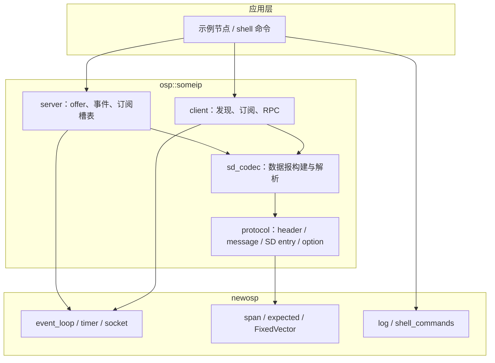

# osp-someip 架构设计

## 1. 范围与目标

本仓库用 C++17 重新实现 SOME/IP（含 Service Discovery），面向嵌入式 Linux 与 RT-Thread，
以 newosp 的头文件库为运行底座。目标不是逐行翻译 Rust 原型，而是保留其线格式与协议行为，
把异步执行器替换为 newosp 的事件循环与静态通道。

| 范围内 | 范围外 |
|---|---|
| SOME/IP 头、消息、SD entry/option 编解码 | E2E Profile 2/4/5/7 |
| SOME/IP-TP 分段头与定容重组（含乱序） | SOME/IP-TP 重叠分段容忍 |
| 服务端 offer/stop-offer、事件发布、订阅管理 | mTLS 与安全传输 |
| E2E 钩子与 Profile 1（CRC-8 + 计数器） | 动态分配、vtable 多态、工厂模式 |
| 客户端发现缓存、订阅、请求-响应匹配 | TLS/mTLS 与安全传输 |
| 定容、零分配、无异常的错误模型 | 动态分配、vtable 多态、工厂模式 |

硬约束：C++17；`-fno-exceptions -fno-rtti` 可构建；热路径零堆；单函数 return 不超过 5 个；
新增常量用 `constexpr`，禁裸 `enum` 与业务 `#define`。

## 2. 架构与模块



模块职责：`protocol` 只做字节与值对象，不碰 socket；`sd_codec` 在调用方缓冲上构建整条 SD 数据报；
`server` 与 `client` 持有定容状态表，通过 `TransportOps` 策略注入收发；应用层只组合，不解析字节。

线格式在 `wire.hpp`（写入器与编码器骨架）、`header.hpp`、`message.hpp`、`payload.hpp`、
`message_id.hpp`、`message_type.hpp`、`return_code.hpp`、`error.hpp`；上层在 `tp.hpp`、
`e2e.hpp`、`e2e_profile1.hpp`、`sd_codec.hpp`、`server.hpp`、`client.hpp`。

## 3. 关键设计决策

### 3.1 编码：CRTP 骨架 + 单一出口

每个线格式类型派生自 `WireEncoder<T>`，只实现两个钩子：

```cpp
std::uint32_t DoEncodedSize() const noexcept;
osp::expected<std::uint32_t, Error> DoEncodeTo(osp::span<std::uint8_t> out) const noexcept;
```

基类的 `EncodedSize()` / `EncodeTo()` 是唯一公共入口，边界检查只写一次；派生类之间没有继承状态，
也没有虚函数表。载荷侧对应 `PayloadCodec<T>`，`Message<Payload>` 通过模板参数选择载荷形态。

### 3.2 解码：视图 + 显式剩余字节

`HeaderView` 与 `MessageView` 只保存 `osp::span<const std::uint8_t>`，解析零拷贝；
`HeaderView::Parse` 返回 `ParsedHeader{view, rest}`，`MessageView::Decode` 返回
`DecodedMessage{view, rest}`，剩余字节由调用方决定丢弃还是继续遍历。

载荷有两种形态：`OpaquePayload` 借用调用方缓冲，编码时直接拷贝；
`OwnedPayload<Capacity>` 在对象内持有最多 Capacity 字节，用于需要让载荷活过输入缓冲的场景
（排队请求、延迟响应），两者都是零堆值类型。

SD 解析沿用同一模式：`EntryView` 固定 16 字节、`OptionView` 按长度字段前进、
`SdHeaderView::Parse` 一次性校验两个分区（`entries_size` 必须是 16 的倍数，选项长度与
传输协议字节必须合法），校验通过后 `NextEntry()` / `NextOption()` 只做切片。未知 entry 类型
被跳过，未知 option 类型保留原位，保证后续 entry 的选项索引不漂移。视图可随时用
`ToEntry()` / `ToOptions()` 还原成值类型。

### 3.3 错误模型

`Error` 是值类型：`ErrorCode` 表示类别，`value` 表示违规值或所需字节数，`available` 表示实际可用字节数。
没有异常、没有字符串、没有堆；调用方用 `osp::expected` 分支处理。

### 3.4 消息遍历

`MessageWalker` 按 Length 字段逐条切分数据报：跳过并计数 SOME/IP-TP 分段；
遇到第一条畸形消息时产出 `WalkItem::Kind::kMalformed` 并停止；无法组成头部的尾部字节由
`Unparsed()` 原样交出。该语义与上游原型一致，后续互操作测试以它为准。

### 3.5 类型纪律

服务/方法 ID、消息类型、返回码都是强类型值对象，构造即校验；返回码保留"命名 / 通用 / 接口"
三段区间，相等性同时比较区间与字节，避免把 `Ok` 与 `Generic(0x00)` 当成同一个值。

### 3.6 静态注入与零堆

服务端不持有 socket，也不做运行期类型擦除：发送通道是模板参数
`Server<Sink, MaxOffers, MaxSubscribers, MaxDatagram>`，`Sink` 在编译期绑定，调用点就是
`sink_(datagram, endpoint)`。因此没有 `std::function`、没有 vtable，也没有为回调分配的内存。

所有容器都是定容数组，唯一的"裸存储"是 `osp::expected` 内部的 `aligned_storage` +
placement new（`vocabulary.hpp`）；本仓库不直接使用 `new`、`delete`、`malloc`。
`tests/no_alloc_witness.cpp` 覆盖 offer → find → subscribe → publish → tick 全链路，
替换全局 `operator new` 后要求分配计数为 0，任何后续引入的 `std::vector` / `std::string`
会直接让该进程返回非零。

### 3.7 UDP 接入

`udp_link.hpp` 只做两件事：把 `Ipv4Endpoint` 转成 `osp::SocketAddress`（`FromIpv4Bytes`，不走文本），
以及把 `Server` 的发送通过 `UdpSocket::SendTo` 发出；接收侧由调用方 `RecvFrom` 后把源地址转回
`Ipv4Endpoint` 再交给 `Server::HandleDatagram`。`tests/test_udp_loopback.cpp` 用真实 UDP 套接字在
127.0.0.1 上跑通 find → offer → subscribe → ack → notification 全链路，不依赖 Docker 与组播。
`JoinSdMulticast()` 封装 `IP_ADD_MEMBERSHIP`，`examples/server_demo.cpp` 用它绑定 30490 并加入
239.255.0.255，可直接在真实网卡上被 vsomeip 发现。

### 3.8 客户端核心

`Client<Sink, Handler, MaxServices, MaxPending>` 与服务端对称：发送通道与回调都在编译期绑定，
状态是定容数组。发现缓存保存 offer 的 service/instance/major、事件端点与 SD 源地址；
`StartFind` 立即发一次后按 100 ms 起、逐次倍增的间隔重发三次；`Request` 用
`client_id(1) << 16 | session` 生成请求 ID 并登记超时；收到的 Response/Error 按请求 ID
匹配后回调 `OnResponse`，`Tick` 到期回调 `OnTimeout`；Notification 直接回调 `OnEvent`；
Subscribe 带上本地端点选项，Ack/Nack 通过 `OnSubscribeAck` 上报授予的 TTL。
服务缓存新增或过期/stop-offer 时分别回调 `OnServiceAvailable` 与 `OnServiceGone`，
与 Rust 的可用性更新流语义对应。
订阅维护在 `Client` 内：`Subscribe` 建档并立即发送，`Tick` 在 TTL 一半时重发续订，
收到 Ack 按授予 TTL 重算到期与续订时刻，收到 Nack（TTL=0）或到期未见续订则注销。
对端重启检测按 SD 源地址记录会话号：若新报文带 RecentlyRebooted 且会话号不增，
判定对端重启，清除该源的服务缓存与订阅并回调 `OnSenderRebooted`。

### 3.9 服务端请求分发

`Server` 的第五个模板参数是 `RequestHandler`，默认 `NoRequestHandler` 忽略所有请求。
收到 Request/RequestNoReturn 时，服务端按 `request_id / service / method / interface_version /
payload / 源端点` 组一个 `IncomingRequest` 交给 `OnRequest`；处理器返回 `RequestReply`，
服务端据此自动编码 Response 或 Error 并回给源端点。fire-and-forget 只分发不回复。
处理器在编译期绑定、按值持有（`Handler()` 可取回状态），无堆、无虚函数。
回复同样经过 E2E `Protect`，保证请求与响应共用一套保护策略。

### 3.10 服务端远端观察者

`Server` 额外接收其他节点的 Offer/StopOffer：远端服务表定容保存服务标识、端点与到期时刻，
首次出现回调 `OnServiceAvailable`，stop-offer 或 TTL 到期回调 `OnServiceGone`。
与本节点自身 offer 相同的公告会被忽略，避免组播回环把本机误判成远端。

### 3.11 E2E 钩子

`Server` 与 `Client` 都接受一个 `E2E` 策略模板参数，默认 `NoE2E`（检查不适用、保护原样返回）。
发送路径（服务端 Publish 与回复、客户端 Request）先把载荷写入缓冲区头部之后，取临时头的
`upper_header` 调 `Protect`，按要求调整后的长度重建头并发送；接收路径先 `Check`，
判定失败直接丢弃，通过后把去掉保护尾的载荷视图交给处理器。策略在编译期绑定，
未启用时没有分支残留。

### 3.12 内置 Profile 1

`E2EProfile1<DataId>` 实现 AUTOSAR Profile 1 的线格式：保护载荷前两个字节是计数器和 CRC，
CRC-8 采用 SAE J1850 参数（poly 0x1D、init 0xFF、终值异或 0xFF），覆盖 16 位数据 ID、
计数器、置零的 CRC 字节和后续数据。`Protect` 先用 `memmove` 把载荷后移两个字节再写头，
因此调用方必须预留两字节空间；`Check` 校验 CRC 并比较计数器，重复计数按重放处理。

### 3.13 SOME/IP-TP 重组

`TpHeader` 解析四字节分段头：28 位偏移以 16 字节为单位，低 1 位为 more 标志，保留位非零即拒绝。
`TpReassembly<MaxPayload, MaxSessions, TimeoutMs>` 按（消息 ID，请求 ID）找槽位，
按 16 字节单元记录哪些字节已到达，因此分段可以乱序；与已收单元重叠的分段视为矛盾并丢弃整条组装，
偏移 0 的重发则重新开始。超时未收到新分段同样丢弃。
重组完成后在现场缓冲区头部重建一个去掉 TP 标志的 16 字节头，返回 `MessageView`，
因此上层的 E2E 检查、RPC 分发和 SD 解析都无需区分是否经过分段。
策略默认 `NoTpReassembly`，不占内存；容量按 `MaxSessions * (MaxPayload + 16)` 计算。

## 4. 验证策略

| 层级 | 内容 | 判定 |
|---|---|---|
| L0 字节 | 手工推导的 golden 字面量、256 值穷举、越界与截断 | `ctest` 全绿，任何字节差异视为缺陷 |
| L1 单机 | 后续 client/server 在 loopback 上互通 | 场景脚本全绿 |
| L2 互操作 | 与 vsomeip 容器对端做 RPC、通知、订阅 | 双向收发一致 |
| L3 目标 | ARM Linux / RT-Thread 构建与静态内存报告 | 无堆、尺寸达标 |

当前 L0/L1 结果：118 个用例、3846 条断言（含 3000 轮确定性变异扫描），外加零分配见证进程；
普通构建、`-fno-exceptions -fno-rtti` 构建与 ASan+UBSan 构建均通过。L2 的组播在真实网卡
（`ens192`）上验证；L3 完成 aarch64 交叉构建与 qemu 运行，117 过、1 跳过。

## 5. 里程碑与风险

| 阶段 | 交付 | 主要风险 |
|---|---|---|
| M0（完成） | header/message/walker + 3 条 golden | 无 |
| M1（完成） | SD entry/option/header 编解码、零拷贝解析、数据报构建器 | option 长度与 entry 计数边界 |
| M2（核心完成） | 服务端 offer/stop-offer、find 应答、订阅槽表、事件发布、RPC 分发、TTL 与重播 | 订阅 TTL 与重播时序 |
| M3（核心完成） | 客户端发现、RPC 匹配、超时、事件回调 | 与 vsomeip 的行为差异 |
| M4（部分完成） | aarch64 交叉构建与 qemu 实测、组播真机验证、vsomeip 双向互操作 | 目标板数据 |

主要风险有三个：一是 SD 时序（offer 重播、TTL 过期）只能靠互操作暴露；
二是 `-Wconversion` 下的大量窄化需要逐处显式转换；三是目标板性能数据不能由 x86 结果外推。
