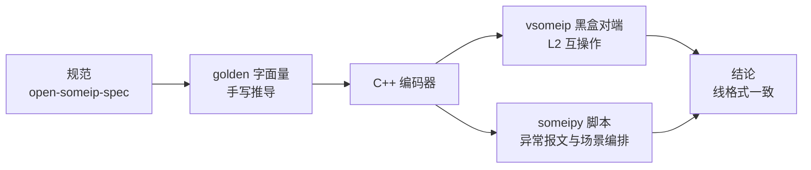

# 参考实现与互操作清单

结论：其他开源 SOME/IP 项目可以参考，但不能当成"照抄源"。参考分三类用途——规范语义、
黑盒互操作对端、工具化验证；只有 permissive 许可证且我们已决定移植的代码才允许进入本仓库。

## 一、用途分类

| 用途 | 允许的做法 | 禁止的做法 |
|---|---|---|
| 规范语义 | 对照报文布局、状态机时序、边界条件，写进设计与测试 | 把规范里的伪代码当成测试 oracle |
| 黑盒对端 | 进程间互操作测试、抓包比对、故障注入 | 链接进产品二进制，或复制其源码 |
| 工具验证 | 用抓包/解析工具定位差异 | 把 GPL 代码复制进本仓库 |

## 二、候选项目

| 项目 | 形态 | 许可证 | 我们怎么用 | 边界 |
|---|---|---|---|---|
| open-someip-spec | 规范文本 | 以仓库为准 | 语义与线格式的第一依据 | 只作规范，不作代码来源 |
| COVESA/vsomeip | C++ 实现 | MPL-2.0 | L2 互操作黑盒对端（3.4.10，用户命名空间 + veth，见 `tools/vsomeip_interop.sh`；对照分析见 `docs/comparison_with_vsomeip_zh.md`） | 不复制源码；MPL 是文件级 copyleft |
| COVESA/commonapi-someip | C++ 绑定层 | MPL-2.0（以仓库为准） | 参考服务接口到载荷的映射方式 | 不复制源码 |
| someipy | Python 实现 | 以仓库 LICENSE 为准 | 用脚本编排 L2 场景、快速造异常报文 | 不进入产品，不作 oracle |
| Wireshark SOME/IP dissector | 解析器 | GPL-2.0（以仓库为准） | `tshark` 抓包比对字段解释 | GPL 代码一律不复制 |
| simple_someip（Rust） | 上游原型 | MIT OR Apache-2.0 | 行为基线与 golden 用例来源，可移植 | 移植时保留许可证声明 |
| automotive-wire-codec（Rust） | 编解码 trait | 以仓库为准 | 参考 Encode/Decode 的职责切分 | 只借鉴接口形状，不逐行翻译 |

许可证一栏凡标"以仓库为准"的，引入前必须打开对应 `LICENSE` 文件复核；本表不作为法律结论。

## 三、三条纪律

1. **oracle 只有规范与手写字面量**：`tests/test_wire_golden.cpp` 的期望字节必须由人按布局推导。
   任何"把某个实现的输出抄成期望值"的做法都视为无效测试，因为它会把对端的缺陷一起继承。
2. **对端只做黑盒**：vsomeip 与 someipy 以独立进程或容器运行，通过 UDP 交互，不共享头文件、不静态链接。
   例外只允许发生在开发机的临时核对程序里（例如比较 E2E CRC），且不得提交、不得作为测试期望值的来源。
3. **每个评审点可追溯**：新增协议行为时，在提交说明里写清依据（规范章节 / 互操作场景 / 抓包），
   便于后续复核"为什么这样实现"。

## 四、验证中的分工

